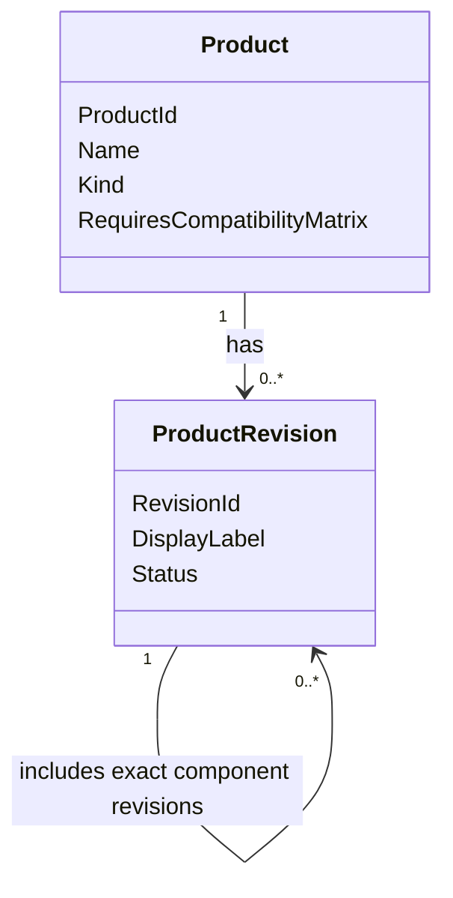
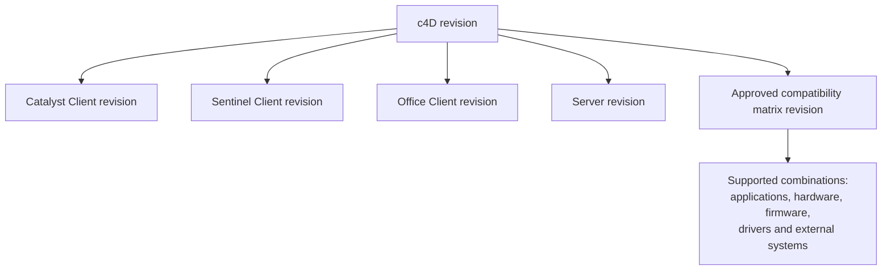
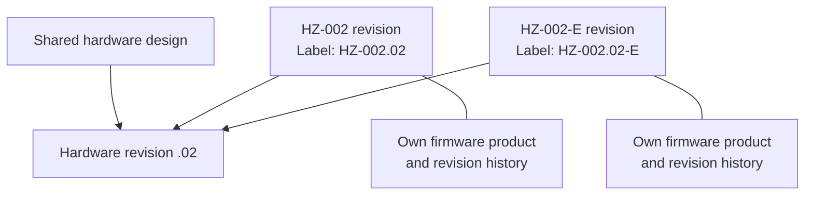
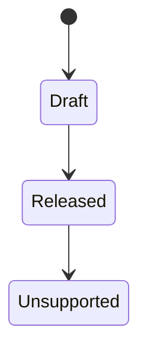
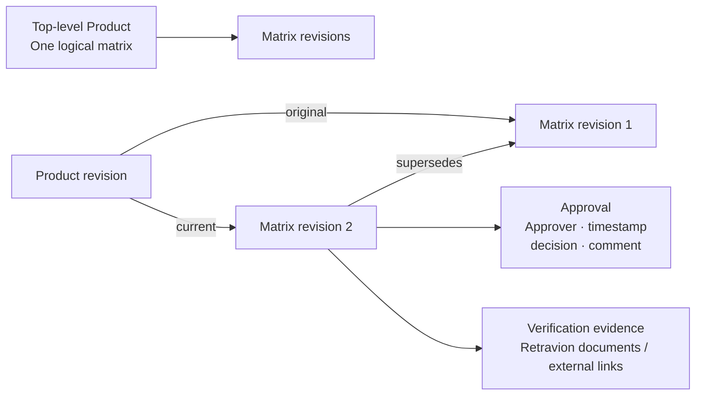
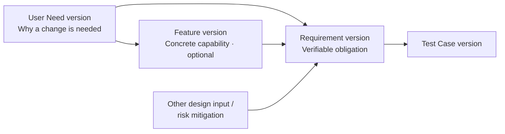
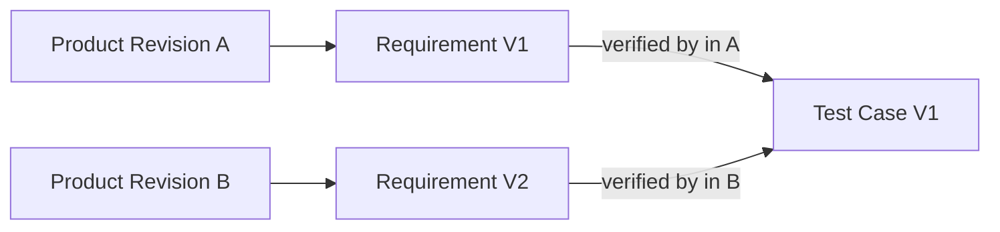
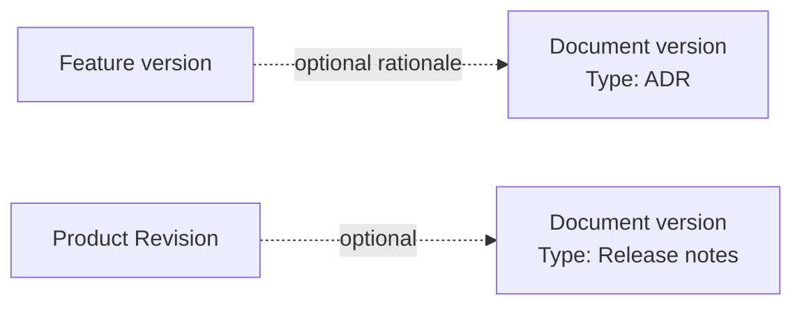

# Domain Model — Working Draft

Interview checkpoints: Products, versioned traceability, and Documents. This is not the complete domain. The original rules were confirmed during the interview; additions labeled **Review proposal** and aggregate boundaries remain proposals. Review proposals clarify the intended structure but are not established domain rules. This document does not establish implementation invariants or replace [domain.md](domain.md). Feature design must confirm applicable rules before implementation.

## 1. Products and revisions

**Product kinds:** System/platform, Software application, Hardware device, Firmware.

- Product IDs are stable.
- Revision labels need not be unique; references use revision IDs.
- A system revision references constituent revisions; it does not own their Products.

## 2. c4D example

**Composition** says what is included. **Compatibility** says what works together.

## 3. Shared hardware, separate products

Products sharing that hardware are intended to adopt hardware revisions together. Their purpose, labeling, and firmware can differ. A shared Hardware Design entity is proposed to represent this relationship.

**Review proposal:** A Hardware Design revision identifies the shared physical design; a Hardware Product Revision identifies a particular Product baseline that references that design revision. They are distinct identities. A design change creates a new Hardware Design revision; it never updates references in released Product Revisions. Coordinated adoption means creating new Product Revisions that reference the new design, not advancing existing released baselines. The coordination workflow remains open.

## 4. Revision lifecycle

- Draft composition may reference Draft components.
- All components must be Released before the system revision is Released.
- If the Product requires a matrix, an approved matrix revision is mandatory.
- Released contents are immutable; Unsupported status preserves the released definition.

**Review proposals:**

- Component release eligibility is checked at the time of system release. A component later becoming Unsupported does not rewrite or automatically invalidate an existing parent baseline. An Unsupported component is not eligible for a new system release under the Released-component rule above.
- Release approval records the approver, timestamp, decision, and comment against the exact baseline being approved; status alone is not the approval record. One approver is sufficient for this proposal. Detailed approval workflow remains open.
- The release baseline preserves the matrix policy applied at release and the original approved matrix reference, when required. Product policy changes apply to future releases; any obligation imposed on existing releases requires a separate explicit decision, not reinterpretation of their release history.

## 5. Compatibility and traceability

- A responsible user, such as a product owner, configures the matrix requirement per Product.
- One logical matrix belongs to the top-level Product; constituent Products do not automatically need separate matrices.
- Each matrix revision applies to **exactly one Product Revision**.
- Approved matrix revisions are immutable.
- A new Product Revision needs a new matrix revision when a matrix is required.
- Later compatibility approval creates a new matrix revision, not new product contents. Applying it requires approval, a comment, and verification evidence links.
- Original/current references and change history are preserved; current means explicitly approved for that release, not automatically newest.
- One approver, timestamp, decision, and comment are recorded; multiple approvers are not currently needed.
- Compatibility uses explicitly supported versions, including hardware revisions and external-system supplier/model/software versions. External dependencies can also have qualified requirements such as a Windows-provided driver.

**Review proposals:**

- The original matrix reference belongs to the immutable release baseline. Later compatibility assessments and their application records are separate from product contents. For later updates, one approval decision both approves the exact matrix revision and applies it to its one target Product Revision; a separate application approval is not proposed.
- Application history is append-only and identifies the target Product Revision, exact matrix revision, approver, timestamp, decision, comment, and evidence references. The current matrix is derived from this history, not from the newest matrix revision or a mutable field inside the frozen baseline.
- Supported entries describe combinations, not independent lists whose cross-product is implicitly supported. An entry may use exact versions or explicit qualified constraints; support is claimed only when the entire assessed configuration matches one entry. Each entry identifies its assessed dependency scope. An omitted dependency is unassessed, not unrestricted or implicitly not applicable; not-applicable dependencies must be explicit. An unlisted combination is unassessed, not necessarily known to be incompatible, and must not be presented as supported.
- Supersession and withdrawal are append-only dispositions; neither edits nor deletes an approved matrix, its evidence references, or its approval history. A withdrawal identifies the matrix, actor, timestamp, and reason. A withdrawn matrix cannot be current; withdrawal does not automatically restore an older matrix. If no replacement is explicitly approved, there is no current approved matrix, while the original release reference remains preserved. The detailed exceptional-correction workflow remains open.

## 6. Proposed DDD classification

An **entity** has stable identity. An **aggregate** is a consistency boundary with a root controlling its changes. A **value object** is defined by its values rather than independent identity.

| Concept | Proposed classification |
|---|---|
| Product | Aggregate root — identity, kind, matrix policy |
| Product Revision | Aggregate root — lifecycle and exact composition |
| Hardware Design | Aggregate root candidate — shared hardware revision history |
| Compatibility Matrix Revision | Aggregate root candidate — supported combinations and approval |
| Composition entry | Value object — component revision reference |
| Compatibility combination | Value object — supported component/dependency constraints |
| Approval record | Immutable value object |
| IDs, revision label, product kind, status | Value types |
| User Need, Feature, Requirement, Test Case, Document | Independently versioned entities; aggregate boundaries still open |
| Baseline selection and traceability link | Value object candidates — exact version references and relationships |
| Document type | Value type candidate — classification, not a separate entity per type |

References between proposed aggregates use IDs. A system is not one enormous aggregate containing all Products.

## 7. Needs, Features, Requirements, and Test Cases

- A User Need describes a desired change, missing functionality, or similar high-level need.
- A Feature is a concrete capability driven by a User Need. A need may require several Features.
- Valid paths: **Need → Requirement → Test Case**, **Requirement → Test Case**, and **Need → Feature → Requirement → Test Case**.
- Requirements must be verifiable; neither a User Need nor a Feature is mandatory for a Requirement.
- A Feature is verified through its linked Requirements and their Test Cases.
- Need–Feature, Need–Requirement, Feature–Requirement, and Requirement–Test Case links can be many-to-many. A Test Case usually verifies one Requirement; a Requirement may need several Test Cases.
- User Needs, Features, Requirements, and Test Cases can be shared across Products and have independent version histories.

## 8. Product Revision baselines

- Each Product Revision selects exact User Need, Feature, Requirement, and Test Case versions as applicable, together with their traceability links.
- Released baselines preserve both selected versions and relationships; later changes do not alter earlier baselines.
- Updating an item does not automatically update related items. Requirement V2 can still be verified by Test Case V1 if the procedure remains suitable.
- Verification mappings belong to the Product Revision baseline: adding the V2 → V1 mapping does not modify Test Case V1 or the earlier baseline.

**Review proposals:**

- Within one Product Revision baseline, select at most one version of each logical User Need, Feature, Requirement, or Test Case. Every baseline traceability link references exact endpoint versions selected in that same baseline; selecting Requirement V2 cannot satisfy a link to Requirement V1.
- Referencing a component Product Revision does not automatically import or flatten its selected items and traceability links into the parent baseline. Component baselines retain their own context. Items needed for parent-level traceability must be explicitly selected, with links satisfying the same endpoint rule. Different component baselines may retain different versions of a shared item; this does not silently resolve them into one parent selection.
- These consistency rules do not require every Requirement to have a User Need or Feature, and do not make optional Documents mandatory.

## 9. Optional, versioned Documents

- One basic **Document entity** with a **Document type**, not separate entities for ADRs, release notes, or verification reports.
- Products, User Needs, Features, Requirements, and Test Cases may all link to Documents; these links are optional.
- Documents have version history. Each link selects an exact Document version rather than following the latest version.
- Verification evidence may be stored in Retravion or linked externally, as described in section 5.

**Review proposals:**

- Document relationships included in a released baseline are frozen with their exact Document versions. Adding a new version or changing a live Product-level document link does not change a historical baseline. Later compatibility evidence belongs to its separate matrix approval history, not to an amendment of the release baseline.
- An external URL alone is a convenience link, not an immutable identification of approval evidence. External approval evidence must identify the reviewed artifact and its exact external revision, with a retained copy or content hash where necessary to distinguish the reviewed content from later changes. A hash identifies content but does not ensure it remains retrievable; evidence retention and storage details remain open.

## 10. Open questions and scope limits

- Confirmation of the Review proposals above during feature design; they are not implementation invariants.
- Coordination workflow for shared hardware revision adoption across new Product Revisions.
- Detailed matrix and release approval workflows within the proposed historical boundaries; detailed Document lifecycle, evidence retention, and storage model.
- Aggregate boundaries and approval lifecycles for User Needs, Features, Requirements, Test Cases, and Documents.
- Test Execution remains unexplored and is later scope; a Test Case is not evidence that a test has been executed.
- Detailed exceptional-correction workflow for previously approved compatibility, including the proposed withdrawal and replacement behavior; deleting approval history is not proposed.
- Evidence reuse across approvals and matrices.
- Nested systems and Product reuse across systems are not current requirements.
- Installed customer systems and third-party product lifecycle management are out of scope for now.
