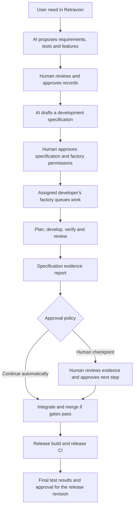
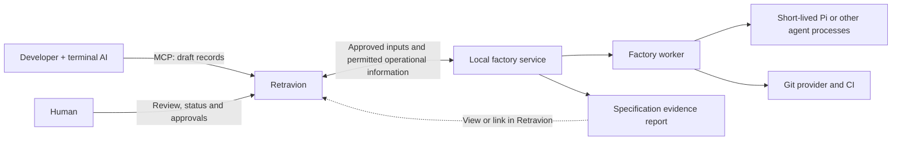
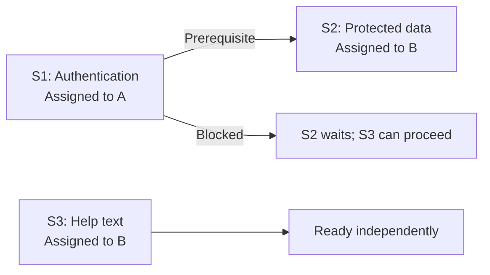

# Product-driven factory: brainstorming summary

**Status:** Ideas for further discussion, not an approved architecture or specification.

## Goal

Reduce routine human interaction while preserving human responsibility for product decisions, QMS approvals and any checkpoints chosen for a development specification. Let independent work continue when another specification is blocked.

## From user need to release

- AI can help draft Retravion records through MCP. MCP only creates or updates drafts; **humans change their statuses**.
- A development specification identifies the intended change, acceptance criteria, scope, linked approved records and evidence expectations. The factory works from a pinned snapshot.
- The approval policy determines which factory stages can proceed unattended. Advance approval never overrides failed checks, blocking findings or unresolved decisions.
- Factory checks provide development evidence; they are **not final test-case approval for a release revision**. The final release build's CI and approval process handle that separately.

## Factory and Retravion

Retravion is the product and quality workspace. A factory service on each developer's machine retrieves work assigned to that developer and coordinates local execution. Workers can start Pi processes as the current factory does; another agent runtime would need its own adapter. Retravion's browser does not need to start processes on the developer's computer.

The exact boundary between local services, Retravion and any shared factory coordinator remains open. Durable state, reliable delivery, recovery after interruption and protection against duplicate execution are necessary before unattended operation.

## Assignment and dependencies

A specification is assigned to a developer. Their local service fetches approved work assigned to them, using a scoped non-interactive credential such as a PAT, if Retravion supports one. A service may need to read minimal dependency status for work assigned to someone else. Credentials must not grant authority to approve QMS records or bypass human status changes.

A shared source must establish when a dependency is satisfied. A possible first rule for work in the same repository is **the prerequisite PR has merged into the relevant target branch**. Cross-repository work may need a released package or another milestone. These rules are not decided yet.

A shared claim or machine assignment is also needed if a developer runs services on multiple computers. A disconnected worker must not be assumed stopped or safe to duplicate. The system must reconcile external effects such as PR creation and merge before retrying.

## Specification evidence report

The factory report should help a reviewer decide whether the specification was fulfilled. It could include:

- Each acceptance criterion, its observed outcome, supporting evidence and gaps.
- Linked test cases: whether relevant automated tests were implemented and passed during factory verification, failed, or remain unverified; identify manual tests separately.
- Captioned screenshots or other artifacts linked to the criteria they support.
- The input snapshot, implementation revision, review outcomes and limitations.

Factory verification is useful evidence but not the final release test result. A test's existence, a passing suite or a screenshot alone does not prove a criterion; unsupported claims remain **not demonstrated**. Retention and QMS treatment of detailed results and artifacts remain to be defined.

## Development specifications and Azure DevOps PBIs

They may overlap, but answer different questions:

| | Development specification | Azure DevOps PBI |
|---|---|---|
| Primary purpose | Define **what outcome is approved**, its acceptance criteria, linked requirements/tests and factory permissions. | Plan and track **when and by whom work is delivered** in a backlog or sprint. |
| Typical owner | Product/quality stakeholders approve the content and applicable policy. | The delivery team manages priority, assignment, sprint and progress. |
| Typical detail | Enough bounded context and evidence expectations for a human or factory to implement and verify. | Enough planning and delivery context for the team; may link to the specification rather than copy it. |

This distinction is a proposal, not a requirement to maintain two full descriptions. A PBI could link to one development specification and remain the sprint-planning item. Larger PBIs might link to several specifications; a small PBI might map to one. Alternatively, the team could eventually use the development specification as the planning item if that meets its DevOps needs.

**Avoid duplication:** choose one authoritative home for each piece of information, link the records, and do not maintain independent copies of acceptance criteria. Ownership of assignment and status between Retravion and Azure DevOps remains an open decision.

## Open questions

1. Is Retravion a shared instance reachable by all developer machines? Which interface can read approved records and provide scoped non-interactive credentials?
2. Where do shared assignments, dependency milestones, claims and machine-reported run outcomes live without changing human-controlled QMS statuses?
3. What exactly satisfies a dependency: merged code, a released component, or another milestone?
4. Which plan and integration stages require human approval by default, and what invalidates advance approval?
5. How are Retravion records versioned or snapshotted, and what happens if they change during a run?
6. How should factory evidence be retained and linked to release-revision verification without implying final test approval?
7. What is the relationship between Retravion specifications and DevOps PBIs, and which system owns sprint assignment and status?
8. Which current factory components can be reused, and which need changes for multiple local services and reliable recovery?

## Possible first experiment

With one developer and one repository, manually queue one approved specification to a local factory service; have it launch the existing factory and show progress and the evidence report in Retravion. Keep human approval and merge gates in place. Then test shared dependency status and assignment before adding unattended merge or multiple concurrent workers.
